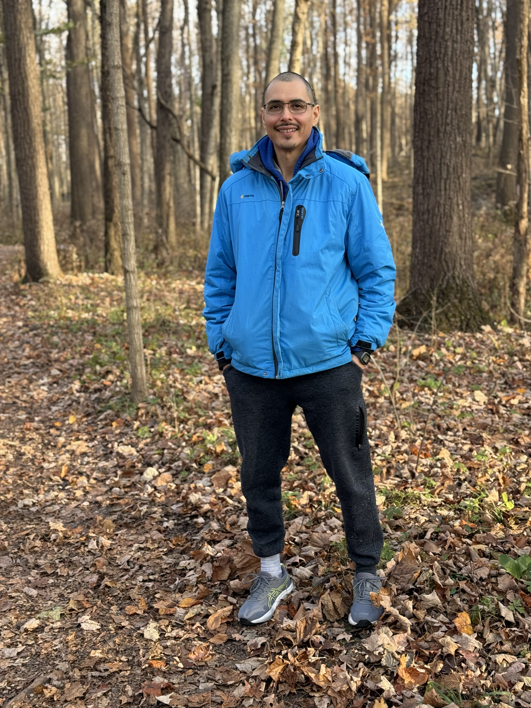

<!-- Profile Header -->

  

  
    

      <h1 style="margin-bottom:10px;">Abel Padilla</h1>
      
Founder, Clear Picture SA

    

  

<!-- Industrial Experience -->

  <h3 style="margin-bottom:15px;">Industrial Experience</h3>
  
Abel brings over 20 years of industrial data experience across multiple sectors, including:

  <ul>
    <li>Oil &amp; Gas</li>
    <li>Chemicals</li>
    <li>Manufacturing</li>
    <li>Pharmaceuticals</li>
  </ul>
  
He has worked extensively with industrial data historians, visualization platforms, and control systems, including:

  <ul>
    <li>PI System (Aveva)</li>
    <li>IOTA Vue (IOTASOFT)</li>
    <li>FrameworX (Tatsoft)</li>
    <li>IP.21 (AspenTech)</li>
    <li>Thingsboard</li>
    <li>Industrial SCADA and HMI systems</li>
  </ul>
  
His work focuses on integrating process data with strong design principles, ensuring industrial users can perceive, understand, and act on information effectively.

<!-- Personal Notes -->

  <h3 style="margin-bottom:15px;">Personal Notes</h3>
  
A Taoist proverb reads: <strong>"Governing a large empire is like frying a small fish"</strong>. Abel believes that what's expressed in this proverb applies to designing an industrial dashboard, as it demands full attention and attentive care, just like frying a fish!

  
Outside of his technical work, Abel enjoys:

  <ul>
    <li>Mexican Food</li>
    <li>Cycling and walking in nature</li>
    <li>Reading</li>
    <li>Art</li>
  </ul>

